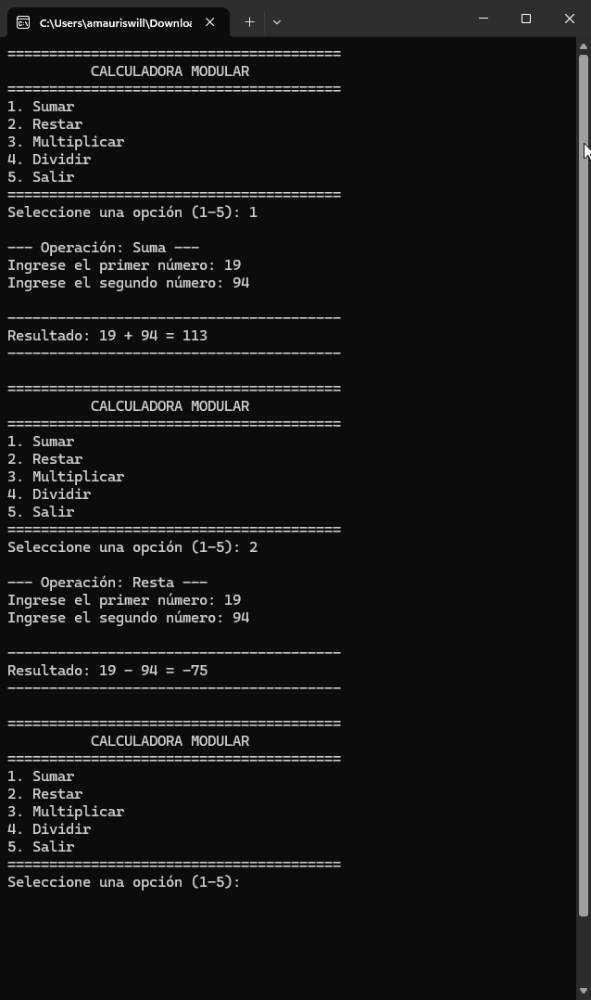
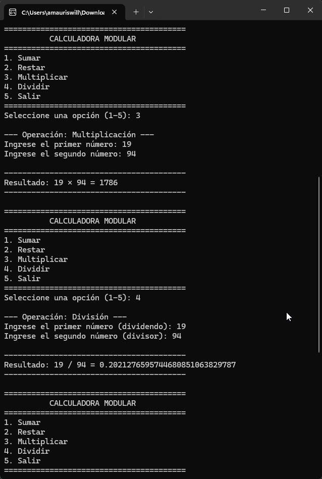
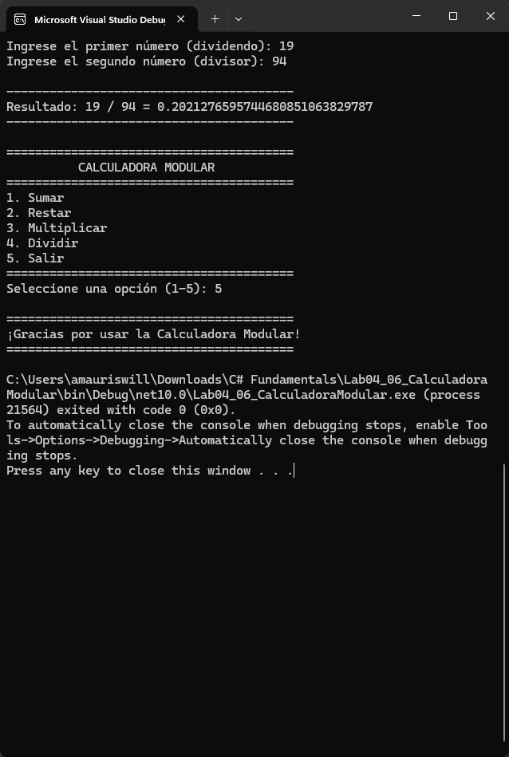

# Laboratorio 4.6 — Calculadora Modular

Aplicación de consola en C# (.NET 10) que implementa operaciones matemáticas mediante métodos independientes, validación de entradas numéricas, control de división entre cero y menú interactivo.

## Evidencia de Ejecución en Windows Terminal

